# Arquitetura do Sistema - MeuFinanceiro

## 1. Visão Geral
O **MeuFinanceiro** é um sistema web de controle financeiro pessoal desenvolvido para a disciplina de Laboratório de Programação (Ciência da Computação - Unifacvest).

A arquitetura adota o modelo de aplicação de página única (**SPA - Single Page Application**) conectada a uma **API REST**, com persistência em banco de dados relacional.

---

## 2. Diagrama de Comunicação entre Camadas

```mermaid
flowchart LR
    subgraph Cliente ["Frontend (Navegador)"]
        UI["React (SPA)\nComponentes, Telas e Gráficos"]
        HTTPClient["Axios / Fetch\nChamadas assíncronas"]
    end

    subgraph Servidor ["Backend (Node.js + Express)"]
        Routes["Rotas (/api/...)"]
        Controllers["Controllers\n(Entrada/Saída HTTP)"]
        Services["Services\n(Regras de negócio e cálculos)"]
        Prisma["Prisma ORM\n(Acesso ao banco)"]
    end

    subgraph Infraestrutura ["Docker"]
        Postgres[("PostgreSQL 16\nTabelas e Relacionamentos")]
    end

    UI --> HTTPClient
    HTTPClient -- "JSON via HTTP (GET, POST, PUT, DELETE)" --> Routes
    Routes --> Controllers
    Controllers --> Services
    Services --> Prisma
    Prisma -- "Consultas SQL" --> Postgres
    Postgres -. "Retorno dos dados" .-> Prisma
    Prisma -.-> Services
    Services -.-> Controllers
    Controllers -. "Resposta JSON" .-> HTTPClient
    HTTPClient -. "Renderização reativa" .-> UI
```

---

## 3. Descrição das Camadas

### 3.1. Frontend (React)
- **Papel:** Interface com o usuário, captura de dados via formulários, exibição de listagens, filtros dinâmicos e gráficos de resumo.
- **Tecnologia:** React (JavaScript moderno via Vite).
- **Comunicação:** Dispara requisições HTTP assíncronas enviando e recebendo dados no formato `JSON`.

### 3.2. Backend (Node.js + Express)
- **Papel:** Processamento de regras de negócio, validação de entradas, cálculo de saldos/totais e controle de rotas.
- **Tecnologia:** Node.js (versão 24.x) e Express.
- **Camadas Internas:**
  - `Routes`: Mapeia endpoints da API (ex: `/api/movimentacoes`, `/api/categorias`).
  - `Controllers`: Extrai parâmetros da requisição e envia respostas HTTP apropriadas (Status 200, 201, 400, 404, 500).
  - `Services`: Contém regras de negócio (ex: cálculo do saldo, validação de valores positivos, bloqueio de exclusão de categorias em uso).
  - `Middlewares`: Tratamento centralizado de erros e validações.

### 3.3. Banco de Dados e ORM (PostgreSQL + Prisma)
- **Papel:** Armazenamento relacional consistente e seguro das categorias e movimentações financeiras.
- **Tecnologia:** PostgreSQL 16 provisionado via container Docker (Docker Compose).
- **ORM:** Prisma ORM para manipulação do banco via código JavaScript tipado, controle de migrações e garantia de integridade referencial.
